I reverse engineer software. I take apart binaries, runtimes, and network traffic to work out how they actually behave and where they break. I got into this by poking at Roblox exploits, spent a while building the defenses against them, and now reverse engineering is what I focus on.

Personal projects here aren't affiliated with or endorsed by the U.S. Army or the Department of Defense.

